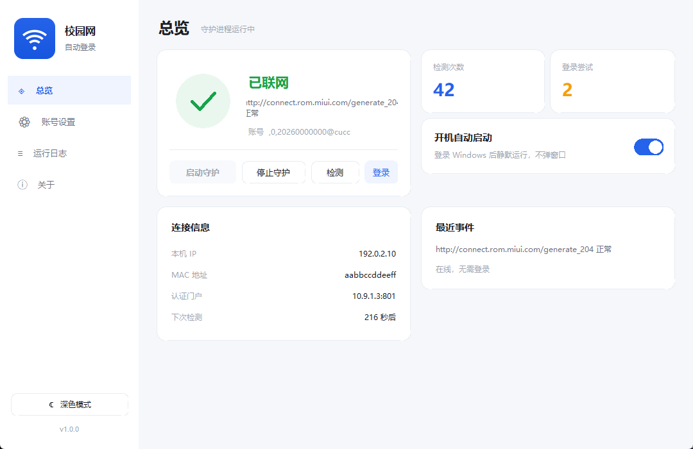
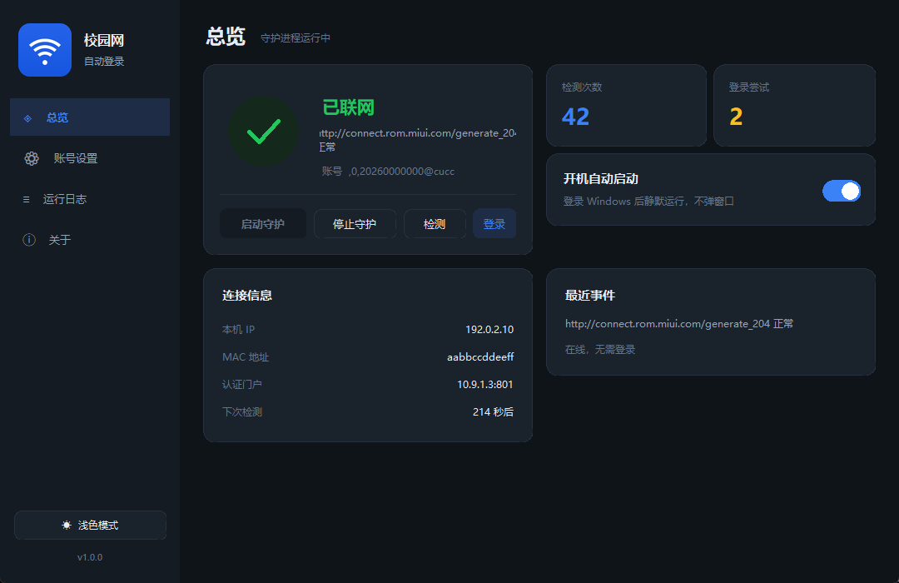
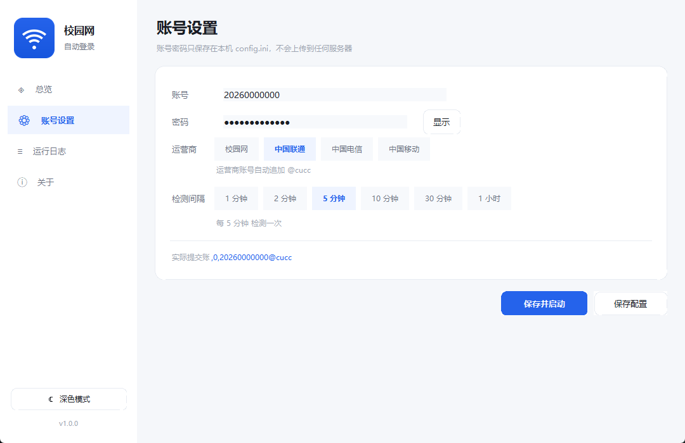

# 校园网自动登录

[](https://www.microsoft.com/windows)
[](../../releases)
[](https://www.python.org/)
[](LICENSE)

针对**苏州大学**校园网认证门户 `10.9.1.3`（Dr.COM / 城市热点 ePortal）的掉线自动重连工具。

定时探测本机能否访问公网；一旦发现掉线（例如账号在别的设备上登录把本机顶下线），
自动用配置好的账号密码重新登录门户，并把过程完整写进日志。

**提供免安装 exe**，双击即用，不需要安装 Python。



---

## 下载使用

到 [Releases](../../releases) 页面下载 `campus-autologin-v1.0.2-win64.zip`，然后：

1. 解压到任意位置（**要解压整个文件夹，不能只拿 exe**）
2. 双击 `启动.cmd`（推荐，可避开 Windows 智能控制的拦截）
   也可以直接双击 `校园网自动登录.exe`
3. 填写账号、密码，选择运营商，设置检测间隔
4. 点「保存并启动」

需要开机自启，就在界面上打开「开机自动启动」开关，一个开关搞定，不需要管理员权限。

> 程序会在 exe 旁边生成 `config.ini`（配置）、`status.json`（状态）和 `logs/`（日志）。
> 卸载时先关闭开机自启，再删除整个文件夹即可。

### 第一次运行被 Windows 拦住？

Windows 11 的「智能控制」会拦截从网络下载的、没有数字签名的程序。本程序没有购买代码签名证书
（个人开发者每年数千元），所以会触发这个机制。**这不是程序有问题**，所有未签名的个人作品都一样。

按顺序试，任一成功即可：

| 方法 | 做法 |
|---|---|
| **用启动器**（推荐） | 双击 `启动.cmd`，由 cmd 调用 exe，绕开拦截 |
| 仍要运行 | 双击 exe → 拦截提示里点「更多信息」→「仍要运行」 |
| 解除锁定 | 右键 exe → 属性 → 勾选「解除锁定」→ 确定 |
| 关闭智能控制 | 设置 → 隐私和安全性 → Windows 安全中心 → 应用和浏览器控制 → 智能控制 |
| 源码运行 | 装 Python 3.9+，执行 `python app.py` |

详细说明见发布包内的 `被拦截怎么办.txt`。

---

## 特性

- **自动重连** — 检测到公网不通时自动登录，正常在线时绝不打扰已有连接
- **现代界面** — 侧栏导航 + 卡片布局，深浅双主题，自绘控件无第三方 UI 库
- **程序内开机自启** — 开关式设置，当前用户级别，不需要管理员权限，静默无窗口
- **实时状态** — 状态环、本机 IP / MAC、检测次数、下次检测倒计时，1.5 秒刷新
- **账号预览** — 直接显示最终提交的完整账号（含 `,0,` 前缀与运营商后缀）
- **防误判** — 连续两轮探测全失败才判定掉线，并识别「被劫持到登录页」
- **失败退避** — 登录失败按 30s → 60s → 120s 指数退避，避免密码错误把账号刷到被锁
- **单实例保护** — 避免多个实例同时登录，把账号反复顶下线
- **零依赖** — 源码模式同样只需 Python 3 标准库

---

## 界面

| 浅色 | 深色 |
|---|---|
|  |  |

账号设置页：



---

## 从源码运行

不下载 exe 也可以直接用源码跑，只需要 Python 3.9+：

```bat
python app.py                 :: 打开图形界面
python auto_login.py --check  :: 只检测网络状态
```

两种方式等价，`app.py` 是统一入口：无参数开界面，带参数走命令行。

### 命令行参数

```bat
python app.py --check         :: 只检测当前网络状态，不登录
python app.py --once          :: 只跑一轮后退出
python app.py --force-login   :: 跳过检测直接登录（调试/救急）
python app.py --daemon        :: 静默后台守护（开机自启使用）
python app.py -v              :: 输出详细探测过程
python app.py -c 其他配置.ini  :: 指定其他配置文件
```

退出码：`0` 成功 / `1` 失败 / `2` 没填账号密码 / `3` 已有实例在运行。

---

## 工作原理

### 检测公网

依次请求以下地址，**任意一个正常**即认为公网通：

| 探测地址 | 期望 |
|---|---|
| `http://connect.rom.miui.com/generate_204` | 204 且响应体为空 |
| `http://www.msftconnecttest.com/connecttest.txt` | 200 且含 `Microsoft Connect Test` |
| `http://www.baidu.com` | 200 |

如果请求被跳到 `10.9.1.3`，或返回了带 `eportal` / `dr.com` 字样的页面，就判定为
「被劫持到登录页」= 掉线。连续两轮全失败才真正触发登录。

### 确定本机 IP

门户认证靠「IP + MAC」识别终端，所以提交的 `wlan_user_ip` 必须是对的。

程序先问系统「访问 `10.9.1.3:801` 时用哪个源地址」，但**装了代理软件时这一步会拿到虚拟网卡地址**
（例如 Clash 常用的 `198.18.0.1`），用它去登录会一直提示密码错误。

所以现在会做过滤：

- 排除 `198.18.0.0/15`（RFC 2544 基准测试网段，代理软件常占用）、`169.254/16`、`192.0.2/24`、`127/8`
- 拿不到可信地址时，枚举所有网卡，优先选 `10.x` 网段的地址（校园网典型网段）

登录失败时日志会写明实际提交的 IP，方便判断是不是取错了网卡。

### 登录门户

先确认门户 `10.9.1.3:801` 可达（不在校园网环境就不盲目尝试），再按登录页的实际协议提交：

```
GET http://10.9.1.3:801/eportal/?c=Portal&a=login
    ?login_method=1
    &user_account=,0,学号@cucc
    &user_password=密码
    &wlan_user_ip=本机IP
    &wlan_user_mac=本机MAC
    &jsVersion=3.3.3
```

账号前缀 `,0,`、运营商后缀、以及各 `ret_code` 错误码的含义，都是从登录页
`a42.js` 里的 `login_portal` / `portal_login_err` 逻辑中提取的。

登录接口返回后还会**再测一次公网**，通了才记录为成功。

### 失败处理

| 情况 | 处理 |
|---|---|
| 账号密码错误（`ret_code=1`） | 记录明确原因，按指数退避重试 |
| IP 已在线（`ret_code=2`） | 视为成功 |
| 提示「已在线」但公网仍不通 | 判定为链路/计费侧问题，记录后等待下一轮 |
| 门户不可达 | 跳过本轮，不做无谓尝试 |

---

## 开机自启是怎么实现的

界面上的开关会写入当前用户注册表：

```
HKCU\Software\Microsoft\Windows\CurrentVersion\Run
  CampusAutoLogin = "…\校园网自动登录.exe" --daemon
```

- 当前用户级别，**不需要管理员权限**
- 带 `--daemon` 参数启动，只跑后台守护，**不弹窗口**
- 注册表写不进去时，自动退回「启动」文件夹方案（放一个 VBS 启动器）
- 关闭开关会同时清理两条路径

---

## 文件说明

| 文件 | 作用 |
|---|---|
| `app.py` | 统一入口：无参数开界面，带参数走命令行 |
| `gui.py` | 图形界面（自绘控件、双主题） |
| `auto_login.py` | 核心逻辑：检测、登录、守护进程、开机自启 |
| `build.spec` / `build_onedir.spec` | PyInstaller 打包配置 |
| `config.example.ini` | 配置模板 |
| `assets/app.ico` | 程序图标 |

运行时产物：`config.ini`、`status.json`、`ui_state.json`、`auto_login.pid`、`logs/auto_login.log`
（均已 `.gitignore`）。

---

## 日志

`logs/auto_login.log`，单文件 1 MB、保留 3 份自动轮转。界面日志页会按级别着色：

```
2026-10-28 09:31:34 [INFO   ] 自动登录守护已启动，检测周期 300 秒，门户 http://10.9.1.3:801
2026-10-28 09:31:36 [WARNING] 检测到公网不可用：http://connect.rom.miui.com/generate_204 无响应
2026-10-28 09:31:37 [INFO   ] 向门户提交登录：账号=,0,20260000000@cucc，本机 IP=192.0.2.10，MAC=aabbccddeeff
2026-10-28 09:31:40 [INFO   ] 登录后校验通过：http://connect.rom.miui.com/generate_204 正常
```

---

## 注意事项

- **密码以明文保存在 `config.ini`**，请勿把配置文件和程序一起发给别人。
  `config.ini` 已被 `.gitignore` 排除。
- 账号若绑定 MAC，换网卡后需要把 `[account]` 里的 `mac` 改成新网卡地址。
- 脚本只在「检测到公网不通」时才登录，**不会主动踢掉正常的连接**。
- 本项目仅适配当前苏州大学 Dr.COM ePortal 门户的协议，其他学校 / 其他版本需要调整
  `[portal]` 配置。
- 仅用于个人便利，请遵守学校网络使用规定。

---

## 许可证

[MIT License](LICENSE)
