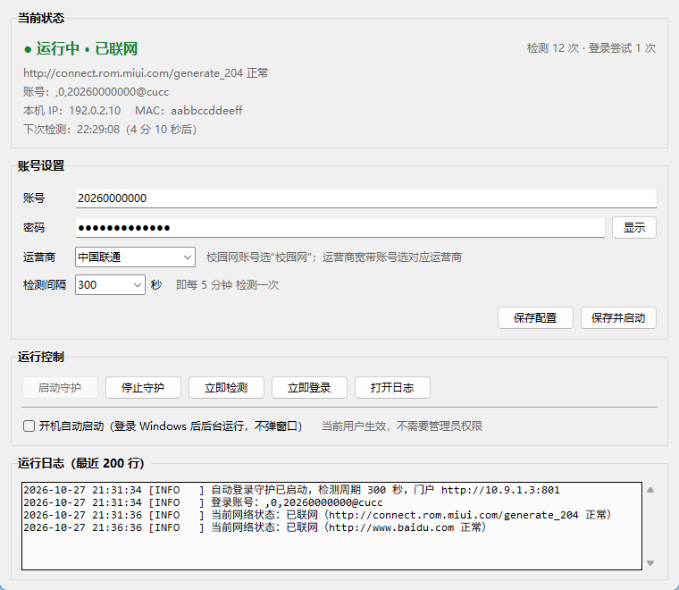

# 校园网自动登录

[](https://www.microsoft.com/windows)
[](https://www.python.org/)
[](LICENSE)
[](CHANGELOG.md)

针对**苏州大学**校园网认证门户 `10.9.1.3`（Dr.COM / 城市热点 ePortal）的掉线自动重连工具。

定时探测本机能否访问公网；一旦发现掉线（例如账号在别的设备上登录把本机顶下线），
自动用配置好的账号密码重新登录门户，并把过程完整写进日志。

**零依赖**：只用 Python 3 标准库，图形界面基于 tkinter，不需要 `pip install` 任何东西。



---

## 特性

- **自动重连** — 检测到公网不通时自动登录，正常在线时绝不打扰已有连接
- **图形界面** — 账号、密码、运营商、检测间隔全部可视化配置
- **开机自启** — 勾选即生效，当前用户级别，不需要管理员权限，无黑窗口
- **实时状态** — 运行状态、最近检测结果、本机 IP / MAC、下次检测倒计时
- **防误判** — 连续两轮探测全失败才判定掉线，并识别「被劫持到登录页」的情况
- **失败退避** — 登录失败按 30s → 60s → 120s 指数退避，避免密码错误把账号刷到被锁
- **单实例保护** — 避免多个实例同时登录，把账号反复顶下线

---

## 快速开始

### 1. 打开界面

双击 **`启动校园网自动登录.vbs`**。

### 2. 填写配置

| 项目 | 说明 |
|---|---|
| 账号 | 统一身份认证用户名（学号 / 工号） |
| 密码 | 校园网密码 |
| 运营商 | 校园网 / 中国联通 `@cucc` / 中国电信 `@ctc` / 中国移动 `@zgyd` |
| 检测间隔 | 任意秒数，最小 30 秒，默认 300 秒（5 分钟） |

点「保存并启动」即可。想随 Windows 自动运行，就在下面勾上「开机自动启动」。

### 3. 验证

点「立即检测」确认探测逻辑正常；想立刻试一次登录，点「立即登录」。

---

## 命令行用法

不想开界面时，脚本本身也能直接用：

```bat
python auto_login.py                 :: 前台常驻，每 5 分钟一轮
python auto_login.py --once          :: 只跑一轮后退出
python auto_login.py --check         :: 只检测当前网络状态，不登录
python auto_login.py --force-login   :: 跳过检测，直接尝试登录
python auto_login.py -v              :: 输出详细探测过程
python auto_login.py -c 其他配置.ini  :: 指定其他配置文件
```

退出码：`0` 成功 / `1` 失败 / `2` 没填账号密码 / `3` 已有实例在运行。

---

## 工作原理

### 检测公网

依次请求以下地址，**任意一个正常**即认为公网通：

| 探测地址 | 期望 |
|---|---|
| `http://connect.rom.miui.com/generate_204` | 204 且响应体为空 |
| `http://www.msftconnecttest.com/connecttest.txt` | 200 且含 `Microsoft Connect Test` |
| `http://www.baidu.com` | 200 |

如果请求被跳到 `10.9.1.3`，或返回了带 `eportal` / `dr.com` 字样的页面，就判定为
「被劫持到登录页」= 掉线。连续两轮全失败才真正触发登录。

### 登录门户

先确认门户 `10.9.1.3:801` 可达（不在校园网环境就不盲目尝试），再按登录页的实际协议提交：

```
GET http://10.9.1.3:801/eportal/?c=Portal&a=login
    ?login_method=1
    &user_account=,0,学号@cucc
    &user_password=密码
    &wlan_user_ip=本机IP
    &wlan_user_mac=本机MAC
    &jsVersion=3.3.3
```

账号前缀 `,0,`、运营商后缀、以及各 `ret_code` 错误码的含义，都是从登录页
`a42.js` 里的 `login_portal` / `portal_login_err` 逻辑中提取的。

登录接口返回后还会**再测一次公网**，通了才记录为成功。

### 失败处理

| 情况 | 处理 |
|---|---|
| 账号密码错误（`ret_code=1`） | 记录明确原因，按指数退避重试 |
| IP 已在线（`ret_code=2`） | 视为成功 |
| 提示「已在线」但公网仍不通 | 判定为链路/计费侧问题，记录后等待下一轮 |
| 门户不可达 | 跳过本轮，不做无谓尝试 |

---

## 开机自启是怎么实现的

勾选后写入当前用户注册表：

```
HKCU\Software\Microsoft\Windows\CurrentVersion\Run
  CampusAutoLogin = "pythonw.exe" "…\auto_login.py"
```

- 当前用户级别，**不需要管理员权限**
- 用 `pythonw.exe` 启动，**不弹控制台窗口**
- 注册表写不进去时，自动退回「启动」文件夹方案（放一个 VBS 启动器）
- 取消勾选会同时清理两条路径

---

## 文件说明

| 文件 | 作用 |
|---|---|
| `启动校园网自动登录.vbs` | 双击打开图形界面（无控制台窗口） |
| `gui.py` | 图形界面 |
| `auto_login.py` | 核心逻辑：检测、登录、守护进程、开机自启 |
| `config.example.ini` | 配置模板 |
| `run.bat` | 命令行前台运行 |
| `docs/screenshot.png` | 界面截图 |

运行时会自动生成 `config.ini`（配置）、`status.json`（实时状态）、
`auto_login.pid`（防重复启动）、`logs/auto_login.log`（日志），这些都不进仓库。

---

## 日志

`logs/auto_login.log`，单文件 1 MB、保留 3 份自动轮转。

```
2026-10-27 21:31:34 [INFO   ] 自动登录守护已启动，检测周期 300 秒，门户 http://10.9.1.3:801
2026-10-27 21:31:36 [WARNING] 检测到公网不可用：http://connect.rom.miui.com/generate_204 无响应
2026-10-27 21:31:37 [INFO   ] 向门户提交登录：账号=,0,20260000000@cucc，本机 IP=192.0.2.10，MAC=aabbccddeeff
2026-10-27 21:31:38 [INFO   ] 登录成功；开始校验网络……
2026-10-27 21:31:40 [INFO   ] 登录后校验通过：http://connect.rom.miui.com/generate_204 正常
```

---

## 注意事项

- **密码是明文保存在 `config.ini` 里的**，请勿把配置文件和程序一起发给别人。
  `config.ini` 已被 `.gitignore` 排除。
- 账号若绑定 MAC，换网卡后需要把 `[account]` 里的 `mac` 改成新网卡地址。
- 脚本只在「检测到公网不通」时才登录，**不会主动踢掉正常的连接**。
- 本项目仅适配当前苏州大学 Dr.COM ePortal 门户的协议，其他学校 / 其他版本需要调整
  `[portal]` 配置。
- 仅用于个人便利，请遵守学校网络使用规定。

---

## 许可证

[MIT License](LICENSE)
